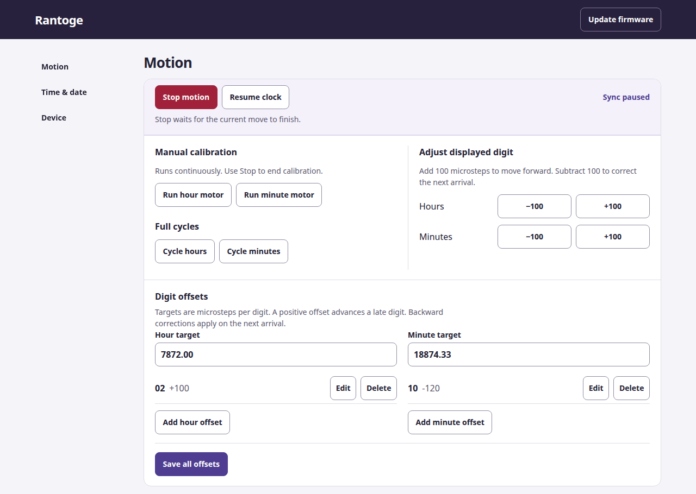
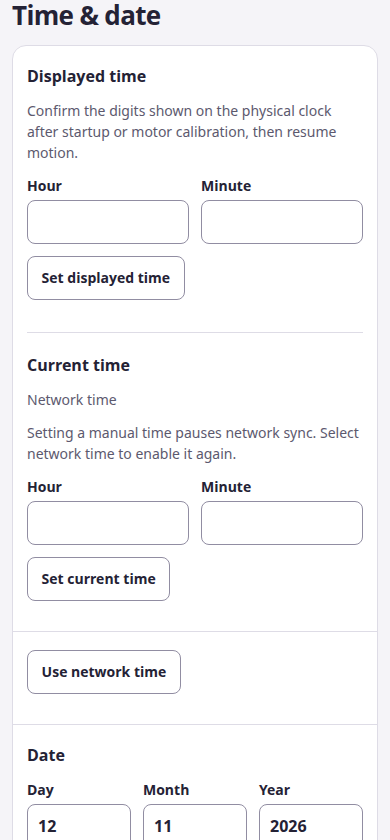
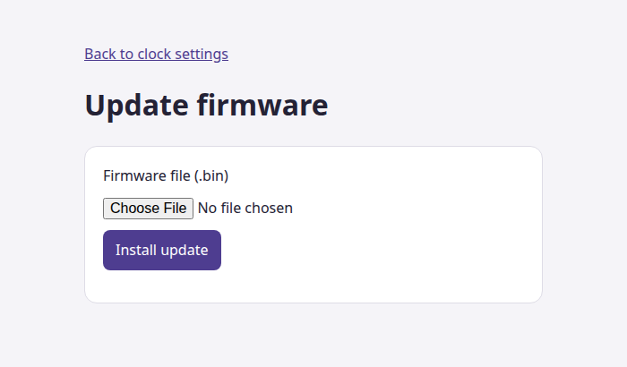

# Rantoge ESP32 Clock Controller

Rantoge drives the hour and minute wheels of an electromechanical clock with two
independent stepper motors. The ESP32 serves a web panel for time, calibration,
Wi-Fi and firmware updates. Physical buttons can jog the motors and align the
display without the web panel.

[Install and connect](#install-and-connect) · [Set the time](#set-the-time-and-resume) ·
[Calibrate](#calibrate-the-display) · [Physical buttons](#physical-buttons) ·
[Update firmware](#update-over-wi-fi) · [Architecture](docs/architecture.md)



The screenshots show the firmware UI with simulated settings.

## Hardware

Use an ESP32 compatible with the PlatformIO `esp32dev` target, two stepper
motors and suitable drivers, and a supply rated for the motors and drivers.
The two buttons and CASIO buzzer are optional. The driver connections below are
logic signals. Connect the motor coils and supply according to the driver
documentation.

| Signal | ESP32 GPIO |
| --- | ---: |
| Hour driver STEP | 21 |
| Hour driver SLEEP control | 22 |
| Minute driver STEP | 18 |
| Minute driver SLEEP control | 19 |
| Left button, active low | 26 |
| Right button, active low | 23 |
| CASIO buzzer output | 16 |

The firmware drives the SLEEP control **low during movement** and **high at
rest**. Check that this matches the driver board and any inverter in the
wiring. Pin assignments and timing are in [`include/settings.h`](include/settings.h).

## Install and connect

Install [PlatformIO Core](https://docs.platformio.org/en/latest/core/installation/index.html)
or the PlatformIO IDE extension. Run the commands below from the repository root.

1. Connect the ESP32 by USB for the first installation. Build and upload the
   firmware, bootloader and partition table with PlatformIO.

   ```sh
   pio run -e esp32dev -t upload
   ```

2. Open the serial monitor at 115200 baud. It prints the station IP address or
   the setup access point address.

   ```sh
   pio device monitor -e esp32dev
   ```

3. When the controller has no working Wi-Fi connection, join the **clock**
   access point and open `http://192.168.4.1/`. Use the address printed on
   serial if it differs.
4. Under **Device → Wi-Fi network**, enter the SSID and password and select
   **Save Wi-Fi settings**. Leave the password empty for an open network.
   The setup connection can close when the controller joins the configured
   network. Rejoin that network and open `http://clock.local/` or the
   controller's IP address.
5. Open **Time & date** and follow the alignment procedure below. The controller
   starts paused after every restart.

If association fails, the setup access point remains available while the
controller retries saved credentials. A prolonged loss of an established
connection also brings back the setup access point. Check the serial output
or **Device → Device log** if the controller is hard to find.

## Set the time and resume

1. Under **Time & date → Time zone**, enter a supported zone such as
   `Europe/Rome` and select **Save time zone**. Without a stored zone the
   controller can try an IP-based lookup after connecting to Wi-Fi.
2. Wait for **Network time** under **Current time**. For offline operation,
   enter the correct date and time manually. Use **Use network time** to
   restore SNTP after setting the time manually.
3. Read the digits on the physical clock. Enter those values under
   **Displayed time** and select **Set displayed time**.
4. Under **Motion**, select **Resume clock**. The panel shows whether
   synchronization is enabled, paused, waiting for time, or waiting for
   confirmation of the displayed digits.



Repeat steps 3 and 4 after a restart, a power interruption, or a manual jog.
The clock has no position sensor. Confirmation gives the controller a starting
reference, so enter the digits actually showing.

**Stop motion** finishes the current digit movement and leaves automatic
synchronization paused. **Resume clock** catches up elapsed time. Following a
backward time correction, an axis ahead of local time waits for it to catch
up. Whole-hour zone changes preserve the minute wheel's progress, including
when the local hour repeats at the end of daylight saving time.

A manual time overrides SNTP until you select **Use network time** or restart.
Editing the date after time acquisition also switches to manual time. Some
zones, including Casablanca, need dated transitions that the firmware's
recurring time-zone rules cannot represent. The panel rejects those names.

## Calibrate the display

### Align a wheel

1. In **Motion → Manual calibration**, select **Run hour motor** or
   **Run minute motor** to jog that motor continuously.
2. Select **Stop motion** when the desired digits are in place.
3. Enter the physical hour and minute under **Displayed time**. Resume when
   ready. A jog invalidates the reference of the axis it moves.

**Cycle hours** and **Cycle minutes** run one complete cycle on the selected
axis. They require a confirmed reference for that axis and preserve the pause
setting. The result appears after the last digit move. Stop can cancel a
cycle between digit moves.

### Set targets and per-digit offsets

1. Under **Motion → Digit offsets**, set the **Hour target** and
   **Minute target** to the average microsteps per digit, with up to two decimal
   places. Defaults are `7872.00` and `18832.00`.
2. Add or edit an offset for each digit that needs a position correction.
   For example, `M10 = +100` places minute 10 another 100 microsteps forward.
   The next digit's departure automatically compensates for that extra travel.
3. Select **Save all offsets** to apply and store the draft. An increase on
   the current digit can move that motor immediately. A decrease applies
   the next time the digit is reached. Saving identical values again leaves
   the current position in place.
4. Use **Adjust displayed digit** for a quick correction of `+100` or `−100`
   microsteps on the referenced digit currently showing. These adjustments are
   saved immediately. The panel preserves unsaved draft edits and asks you to
   reload settings if another browser changes them first.

The controller rejects any configuration that needs a nonpositive move or
exceeds its ten-second pulse budget for a digit movement or immediate
correction. See [motion planning](docs/architecture.md#motion-planning)
for the fractional step calculation.

## Physical buttons

| Gesture | Effect |
| --- | --- |
| Hold left or right | Jog the hour or minute wheel. Release to end that button's jog. |
| Left triple-click with no hour reference | Confirm the hour wheel at `00`. Position it there first. |
| Left triple-click with both references and usable time | Resume synchronization. |
| Right triple-click outside minute setup | Start minute setup. |
| Right single-click during minute setup | Advance the minute wheel one digit and wait. |
| Right double-click during minute setup | Confirm the displayed `00`. |
| Right triple-click during minute setup | Mark the digit corresponding to the current minute. |

For offline minute setup, mark both `00` and the current minute, in either
order. Make each gesture with the wheel stationary. Use a left triple-click
or the web panel to resume once both references and time are available.
Outside setup, a single or double click adjusts the logical reference for the
corresponding axis. With synchronization enabled, the motor advances or
waits to reconcile that reference with local time.

## Update over Wi-Fi

Build the `esp32dev` firmware from the repository root.

```sh
pio run -e esp32dev
```

For OTA, select **`.pio/build/esp32dev/firmware.bin`**. This is the application
image produced by the command above. If the device still shows the previous
OTA page, use its upload control with the same file. The new page appears
after reboot.

1. Open the clock's web panel and select **Update firmware**, or go to
   `http://clock.local/update` or `http://<device-ip>/update`.
2. Select `firmware.bin` and press **Install update**.
3. Wait for installation and reboot. The update page waits for the current
   motor movement to finish before upload. An incomplete or rejected image
   leaves the controller running and can be retried.
4. Reconnect to the panel, confirm **Displayed time**, and select
   **Resume clock**.



Wi-Fi and OTA are always enabled. The setup access point, web panel and OTA
page are intended for a trusted local network and require no credentials.
Use USB upload if the ESP32 has no working firmware or an OTA-capable
partition table yet.

## Device settings

- **CASIO hourly beep** supports Off, All day and 08:00–23:59 local time.
  **Calibration beep** adds a cue for minute-only movements.
- **Restart device** reboots after the current movement finishes.
- **Factory reset** clears saved Wi-Fi, clock and calibration settings before
  reboot. Rejoin the **clock** setup network and configure the device again.
- **Device log** shows recent messages. Use the serial monitor for boot output.

## Development and tests

```sh
python3 test/run_host_tests.py
pio run -e esp32dev
```

Host tests require Python 3, g++ with AddressSanitizer and
UndefinedBehaviorSanitizer, and Node.js. They run the real clock and OTA
controller code against simulated GPIO, time, NVS, queues and upload requests.
They also exercise the JavaScript embedded in the firmware. Check real motor
alignment, timing and OTA on the device after a firmware change.

The web panel is embedded in [`include/HTML.h`](include/HTML.h). Run
`./extract_html.sh` to regenerate `test.html` after editing it. The preview
needs a device or simulated endpoints to populate settings. `fromesp.html`
is a historical capture.

See [Architecture](docs/architecture.md) for component boundaries, command
ordering, storage and the OTA sequence.
