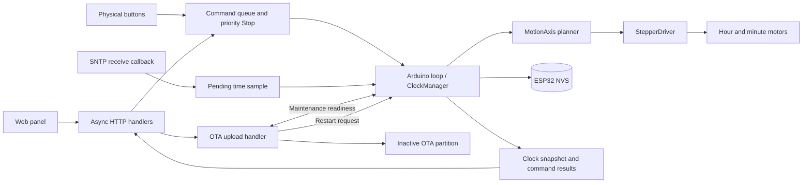

# Rantoge firmware architecture

[User guide and build instructions](../README.md)

The default target is `esp32dev` with Arduino and FreeRTOS. The clock has two
independent, forward-only stepper axes with 24 hour positions and 60 minute
positions. The controller tracks emitted pulses in software. The hardware
provides no encoder or absolute position signal.

## Components and ownership

| Component | Responsibility |
| --- | --- |
| [`main.cpp`](../src/main.cpp) and [`HTML.h`](../include/HTML.h) | ESP32 setup, HTTP routes, physical button callbacks, web panel, reset scheduling and device log |
| [`ClockManager`](../src/ClockManager.cpp) | Command queue, time source, physical references, automatic motion, calibration, configuration and status |
| [`MotionAxis`](../include/MotionAxis.h) and [`StepperDriver`](../src/StepperDriver.cpp) | Per-axis planning, exact pulse output, driver wake and sleep timing |
| [`WifiManager`](../src/WifiManager.cpp) | Station connection, setup access point, saved credentials, reconnect and mDNS |
| [`TimeZoneManager`](../src/TimeZoneManager.cpp) | Named zone lookup, recurring POSIX rules, persistence and optional IP lookup |
| [`OtaManager`](../src/OtaManager.cpp) | OTA page, maintenance readiness, image upload and restart handoff |
| [`CASIO`](../src/CASIO.cpp) | Hourly chime and optional minute-movement cue |

## Time and physical reference

Startup loads settings and starts Wi-Fi and the web server. SNTP acquires time
in the background. The SDK's time receive hook stores a sample with its
monotonic receipt time. The Arduino loop applies it, including time spent
waiting for a motor move to finish. Manual time disables SNTP until the
operator selects network time again. Time-zone changes share the loop's
command queue with manual time and date changes.

Each axis holds a confirmed digit, its validity, and the last civil-time
position it reached. The initial reference uses the nearest matching phase
of the corresponding wheel. Automatic movement requires both references, a
usable time source, and an explicit Resume. An unmeasured jog invalidates
the moved axis. Boot starts with both axes unreferenced.

The two civil-time cursors distinguish elapsed forward time from a backward
clock correction. A cursor ahead of local time waits. The controller can
skip complete revolutions in either cursor because they leave the displayed
digit unchanged. Whole-hour time-zone changes rebase the minute cursor
without losing elapsed minute progress. The chime follows an observed civil
hour boundary.

Minute setup advances one digit per single-click command. Debounced press
and release callbacks capture the minute movement generation. A mark is
discarded if a callback observes movement or the generation changes before
execution. Without a usable external time, the zero and current-minute
marks establish the minute and preserve a known hour.

## Motion planning

Targets are stored as integer hundredths of a microstep per digit. Each
axis carries its fractional remainder across transitions, including across
the zero digit. A transition adds the base microsteps, any whole microstep
from the accumulated fraction, and the destination offset minus the
currently applied offset.

For example, at a minute target of `18874.33`, 100 moves with zero offsets
emit `1,887,433` pulses. A `+100` offset at minute 10 adds 100 pulses on
arrival and removes 100 from the departure to minute 11. A downward edit to
the current digit's offset is deferred until the next arrival. Reconfirming
the same referenced digit preserves its actual applied offset.

`StepperDriver` emits bounded pulse sequences for both motors. Hour and
minute pulses are scheduled every 12 and 5 slots respectively. A normal slot
has a 54 μs delay. Slow calibration uses four times that delay. The planner
enforces the ten-second pulse budget before applying settings. Physical
motion, settling and total wall time depend on the driver and hardware.

## Commands, status and persistence

Web commands and button gestures enqueue work. The Arduino loop owns motor
movement, time changes and motion configuration. Stop uses a separate
priority mailbox with an epoch that invalidates earlier commands. The loop
finishes the digit move it has already claimed. Continuous jogs run in
32-pulse batches. Completed Stop results are retained separately from the
ordinary result ring.

An accepted web command returns HTTP `202` with `id` and `boot`. Poll
`/command-status?id=<id>&boot=<boot>` until `done`. The boot token scopes
command IDs to a single boot. An ordinary command that cannot be queued
returns `503`. Cycle commands complete after their final move or return an
interruption result. The panel also reads `/clock-state` and, when open,
`/device-log`. The latter returns up to 16 recent messages from a bounded
buffer.

| NVS record | Contents |
| --- | --- |
| `motion/config` | Versioned targets and both positional offset arrays in one record |
| `wifi/credentials` | SSID and password, with legacy separate keys read as a fallback |
| `time/tz_name` | Time-zone name. The legacy `time/tz` value is read when only that value is present. |
| `time/casio_config` | Chime mode and calibration cue, with legacy keys read as a fallback |

Motion settings are validated before persistence or pulse output. Version 2
stores positional offsets. Older zero-sum arrival offsets can be converted
to equivalent relative positions. The legacy `base-steps` namespace can
supply shortened fixed-point target keys or whole-step targets. Fractional
carry, applied offsets and physical references live in RAM.

## Wi-Fi, OTA and restart

The Wi-Fi manager tries saved credentials as a station. A failed attempt
falls back to the `clock` access point and retries saved credentials.
An extended station outage also reopens the access point. Network and
device settings are served over the local network.

The OTA page at `/update` requests maintenance and polls for readiness.
The loop completes its current movement, stops motion and acknowledges
maintenance. The HTTP upload handler then writes the expected number of
application image bytes to the inactive OTA partition. It rejects
incomplete uploads and aborts a disconnected upload. Unused preparation
expires. Wi-Fi reconfiguration and ordinary reset requests are deferred or
rejected while the update is active. A successful image install schedules
the restart. The next boot requires a fresh display reference.

Wi-Fi and OTA are compiled in unconditionally. The OTA page requires no
credentials. The [user guide](../README.md#update-over-wi-fi) gives the
build command and file to upload.
